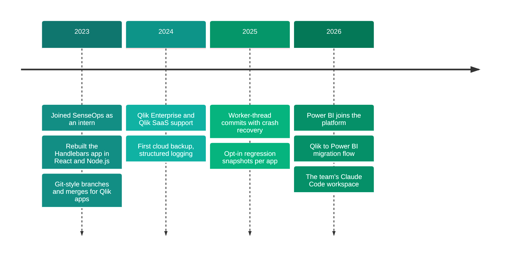
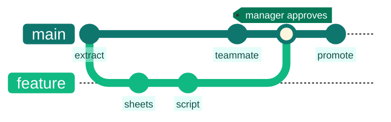

<picture>
  <source media="(prefers-color-scheme: dark)" srcset="profile-assets/banner-dark.svg" />
  
</picture>

  

I joined SenseOps as an intern in February 2023. Eight months later I rebuilt our server-rendered Handlebars app as a React and Node.js codebase, and that codebase still runs the product: a SaaS platform that gives Qlik Sense and Power BI teams version control, deployment and migration.

Three years on, I own its architecture, its versioning core and its platform adapters. I also set up and run the team's Claude Code workspace. I write most of my code in TypeScript on the PERN stack (PostgreSQL, Express, React, Node.js).

## The journey

## What I build

<table>
<tr>
<td width="33%" valign="top">

**Versioning for BI apps**

Repositories, branches, compare and merge for Qlik and Power BI apps, with a manager approving each change before it's promoted.

</td>
<td width="33%" valign="top">

**Platform adapters**

Qlik Enterprise, Qlik SaaS and Power BI behind a single dispatch, with Fabric extraction, Entra sign-in and embedded reports.

</td>
<td width="33%" valign="top">

**Migration**

The Qlik to Power BI flow in our team's Migrator, producing PBIP projects that open cleanly in Power BI Desktop.

</td>
</tr>
<tr>
<td valign="top">

**Security**

AES-256-GCM payload encryption, secrets encrypted at rest and masked in the API, nonce-bound sign-in, identity taken from the token.

</td>
<td valign="top">

**Reliability**

Worker threads, retry and backoff, scheduled jobs, and housekeeping that quarantines, purges and restores stale apps.

</td>
<td valign="top">

**AI tooling**

The team's Claude Code setup: rules, skills, review agents, git hooks and browser checks with Playwright MCP.

</td>
</tr>
</table>

## How versioning works

A developer branches a Qlik or Power BI app and commits changes to it. The server compares the branch with its parent item by item (sheets, scripts, measures, report files), and a manager approves the merge against the latest destination commit before the change is promoted.

## Lessons from production

- **Browser-run user sync was unsafe.** A dropped connection could leave users half-deactivated, and an empty or failed fetch could deactivate everyone. I moved sync to the server, with guards and a log the client polls.
- **Power BI Desktop is stricter than the schema.** It refused our migration output over one-way one-to-one relationships. I fixed the cause and added a shape check against Desktop-saved samples to the pre-commit hook.
- **Secrets need a marker.** Legacy plaintext and ciphertext looked the same in the database, so stored secrets now carry a version tag, and the API returns only a mask.

## Current work

| Area | What I'm doing | Stack |
|---|---|---|
| Power BI in the platform | Fabric-based extraction, compare by file category, per-item merge, embedded reports | `Power BI REST` `Fabric` `Entra ID` `PBIP` |
| Qlik to Power BI migration | Mapping catalog, validator, one honest migration percentage, Desktop-safe output | `Qlik Engine API` `Power Query M` `Node.js` |
| Team AI workspace | Skills, review agents, hooks and Playwright MCP UI checks for the whole team | `Claude Code` `MCP` `Playwright` |

## Technology

| Area | Tools |
|---|---|
| Frontend | React, TypeScript, Vite, MUI, Tailwind CSS, React Hook Form, React Router |
| Backend | Node.js, Express, Sequelize, PostgreSQL (JSONB), JWT, WebSockets, worker threads, Pino |
| BI platforms | Qlik Engine API (enigma.js), QRS, Qlik SaaS, Power BI REST and Embedded, Fabric, Microsoft Entra |
| Tooling | Git, GitHub, Bitbucket, Playwright, Postman, Webpack, Figma |
| AI | Claude Code, agent skills, subagents, MCP |
| Learning | Docker, CI/CD and Nginx; React Query and Zustand; RAG with open-source LLMs; Next.js |

## Experience

| | Role | Focus |
|---|---|---|
| **Now** | Software Engineer, SenseOps | Power BI platform, server-side sync, housekeeping, Migrator flow, AI workspace |
| | Associate Engineer, SenseOps | Qlik Enterprise and SaaS, cloud backup, worker threads, regression module |
| **Feb 2023** | Intern, SenseOps | Joined the BI DevOps platform team, then rebuilt its codebase in React and Node.js |

<b>Earlier projects and archived tech</b>

 

| Project | What it explored |
|---|---|
| [AlvasNiraamaya](https://github.com/AneshSM/AlvasNiraamaya) | My college major project, a React Native patient app for an Ayurvedic hospital |
| [backend-js-template](https://github.com/AneshSM/backend-js-template) | A minimal, production-ready Express.js backend template with ES modules |
| [express-typescript-setup](https://github.com/AneshSM/express-typescript-setup) | An Express and TypeScript boilerplate |
| [restful_API-PostgreSQL_Prisma](https://github.com/AneshSM/restful_API-PostgreSQL_Prisma) | A REST API with Express, TypeScript, Prisma, and PostgreSQL |
| [restful_API-PostgreSQL_Sequelize](https://github.com/AneshSM/restful_API-PostgreSQL_Sequelize) | The same REST API on Sequelize, to compare ORMs |
| [vite-react_ts-mui-setup](https://github.com/AneshSM/vite-react_ts-mui-setup) | A Vite, React, TypeScript, and Material UI starter |
| [ReactJS-Projects](https://github.com/AneshSM/ReactJS-Projects) | Small projects I built to learn React |

Archived tech, for now: Java, PHP, MongoDB, MySQL.

## Get in touch

**Ask me about:** Qlik Engine API, Power BI and Fabric, merge and compare engines, worker-thread pipelines, Claude Code workflows.

 

<i>"Obsessed with clean code, scalable design, and always building the next better thing."</i>

  

Off the keyboard I sketch. The drawings live on my <a href="https://www.instagram.com/arto.beginner">art page</a>.

