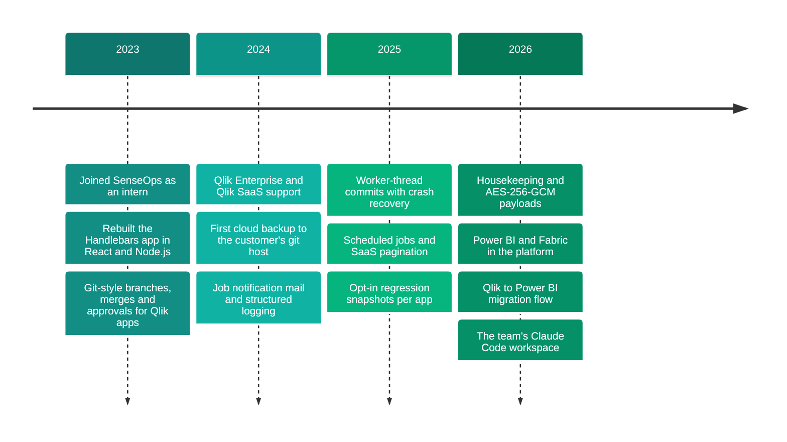
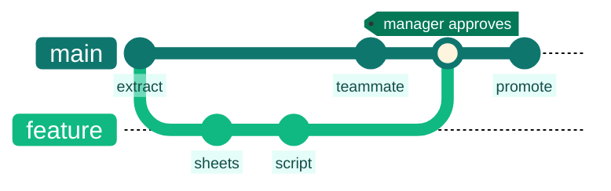

<picture>
  <source media="(prefers-color-scheme: dark)" srcset="profile-assets/banner-dark.svg" />
  
</picture>

  

I joined SenseOps as an intern in February 2023. Eight months later I rebuilt our server-rendered Handlebars app as a React and Node.js codebase. That codebase still runs Code Management, a SaaS platform that gives Qlik Sense and Power BI teams version control, deployment and migration.

Three years on, I own its architecture base, the versioning core, and the Qlik and Power BI platform adapters. I also own the Qlik to Power BI flow in our team's Migrator, and I set up and run the team's Claude Code workspace. I write most of my code in TypeScript on the PERN stack, which is PostgreSQL, Express, React and Node.js.

## The journey

## What I build

<table>
<tr>
<td width="33%" valign="top">

**Versioning for BI apps**

Qlik and Power BI apps get repositories, branches, commits, compare and merge. A manager approves each merge against the latest destination commit, and a commit graph shows the history.

</td>
<td width="33%" valign="top">

**Platform adapters**

One dispatch layer and a capability catalog cover Qlik Enterprise, Qlik SaaS and Power BI. The adapters use the Qlik Engine API through enigma.js, QRS, certificates and tokens, Fabric extraction, Entra sign-in and embedded reports.

</td>
<td width="33%" valign="top">

**BI migration**

The Qlik to Power BI flow in Migrator has a mapping catalog, a validator, a per-visual picker, theme and layout support, and one migration percentage. Its PBIP output opens in Power BI Desktop.

</td>
</tr>
<tr>
<td valign="top">

**Security**

Payloads use AES-256-GCM encryption, with gzip for large responses. Client secrets are encrypted at rest and masked in the API. Power BI sign-in is bound to a nonce, identity comes from the signed token, and git commands run as argument lists.

</td>
<td valign="top">

**Reliability and data lifecycle**

Jobs run on worker threads with retry, backoff, crash recovery and schedules. Housekeeping finds stale and duplicate apps, quarantines them, and can purge or restore them. Cloud backup mirrors repositories to the customer's git host.

</td>
<td valign="top">

**AI-assisted engineering**

I built the team's Claude Code workspace. It has rules, local skill plugins, skill linting, review agents, identity and commit hooks, and a UI verifier agent that drives the browser through Playwright MCP.

</td>
</tr>
</table>

## Architecture in practice

A developer branches a Qlik or Power BI app and commits changes to it. The server compares the branch with its parent item by item, such as sheets, scripts, measures and report files. A manager then approves the merge against the latest destination commit, and the change is promoted. After a commit, worker threads send mail, update merge requests and run backups, so the user doesn't wait for them.

## Lessons from production

- **Browser-run user sync was unsafe.** A dropped connection could leave users half-deactivated, and an empty or failed fetch could deactivate everyone. I moved sync to the server, with guards, concurrency-safe upserts and a log the client polls.
- **Power BI Desktop is stricter than the schema.** It refused our migration output because of one-way one-to-one relationships and wrapped gradient stops. I fixed both causes and added a shape check against Desktop-saved samples to the pre-commit hook.
- **Secrets need a marker.** Legacy plaintext and ciphertext looked the same in the database, so stored secrets now carry a version tag, and the API returns only a mask.
- **Encrypted payloads need compression.** Regression and compare responses grew large, so the server now gzips payloads over 512 KB before it encrypts them, and it returns 400 for a bad payload.

## Current work

| Area | What I'm doing | Stack |
|---|---|---|
| Power BI in Code Management | Fabric-based extraction, compare by file category, per-item merge, separate Fabric and Power BI consent, embedded reports, semantic model refresh | `Power BI REST` `Fabric` `Entra ID` `PBIP` |
| Qlik to Power BI migration | One Qlik extract reused for review and migration, OAuth connections, mapping catalog, validator, migration path registry | `Qlik Engine API` `Power Query M` `Express 5` `TanStack Query` |
| Sync and governance | Server-side user and project sync, Entra group names for Power BI users, housekeeping | `Node.js` `PostgreSQL` `worker threads` |
| Team AI workspace | Skills, review agents, hooks and Playwright MCP UI checks | `Claude Code` `MCP` `Playwright` |

## How I work

- I ship features as matching client and server changes, and I fix teammates' features when they break in my areas.
- I record design decisions in ADRs, including the ones a later ADR replaces.
- I write commits in Conventional Commits format, with the reason in the body.
- I use Claude Code with skills, subagents and MCP servers, and I check UI changes in a real browser before I call them done.

## Tech stack

**Languages and frontend**

React Router, React Hook Form with Yup, TanStack Query, react-window, Web Crypto, IndexedDB, @gitgraph/js

**Backend and data**

REST APIs, JWT, OAuth and SSO, WebSockets, worker threads, node-schedule, pino, PostgreSQL JSONB, Umzug migrations

**BI platforms**

Qlik Engine API (enigma.js), QRS, Qlik SaaS, Power BI REST and Embedded, PBIP, Power Query M

**Tools and AI**

I'm learning Docker, CI/CD and Nginx for deployment, Zustand for state, RAG with open-source LLMs for AI assistants, and Next.js with edge functions and serverless.

## Experience

| When | Role at SenseOps | Focus |
|---|---|---|
| **Now** | Software Engineer | Power BI platform, server-side sync, housekeeping, the Migrator flow, the team's AI workspace |
| | Associate Engineer | Qlik Enterprise and SaaS, cloud backup, worker threads, regression module |
| **Feb 2023** | Intern | Joined the BI DevOps platform team, then rebuilt its codebase in React and Node.js |

My work is in private company repos, so my public GitHub activity is low. The 2,800+ commits are across the product repos since October 2023.

<b>Earlier projects and archived tech</b>

 

| Project | What it explored |
|---|---|
| [AlvasNiraamaya](https://github.com/AneshSM/AlvasNiraamaya) | My college major project, a React Native patient app for an Ayurvedic hospital |
| [backend-js-template](https://github.com/AneshSM/backend-js-template) | A minimal, production-ready Express.js backend template with ES modules |
| [express-typescript-setup](https://github.com/AneshSM/express-typescript-setup) | An Express and TypeScript boilerplate |
| [restful_API-PostgreSQL_Prisma](https://github.com/AneshSM/restful_API-PostgreSQL_Prisma) | A REST API with Express, TypeScript, Prisma, and PostgreSQL |
| [restful_API-PostgreSQL_Sequelize](https://github.com/AneshSM/restful_API-PostgreSQL_Sequelize) | The same REST API on Sequelize, to compare ORMs |
| [vite-react_ts-mui-setup](https://github.com/AneshSM/vite-react_ts-mui-setup) | A Vite, React, TypeScript, and Material UI starter |
| [ReactJS-Projects](https://github.com/AneshSM/ReactJS-Projects) | Small projects I built to learn React |

Archived tech, for now:

## Beyond code

I sketch, and I post my drawings on my [Instagram art page](https://www.instagram.com/arto.beginner).

## Get in touch

**Ask me about:** Qlik Engine API, Power BI and Fabric, merge and compare engines, worker-thread pipelines, Claude Code workflows.

 

<i>"Obsessed with clean code, scalable design, and always building the next better thing."</i>

