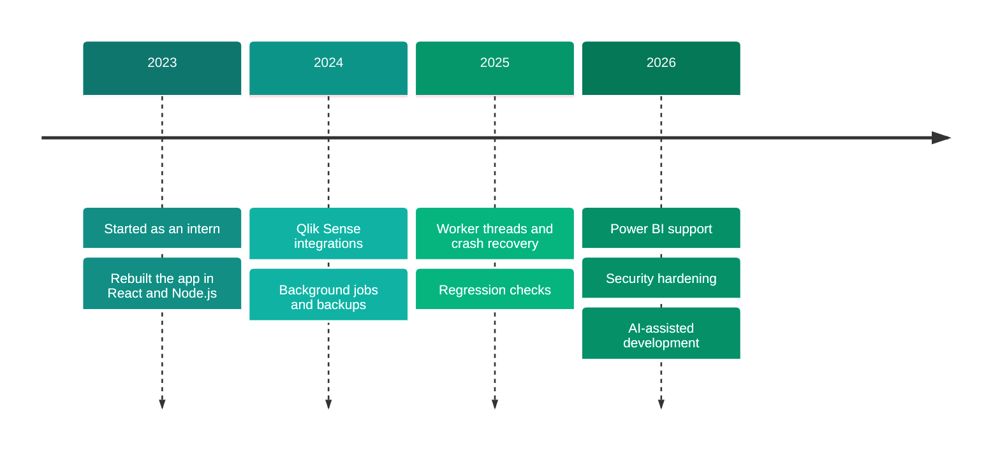

<picture>
  <source media="(prefers-color-scheme: dark)" srcset="profile-assets/banner-dark.svg" />
  
</picture>

  

I'm a full stack developer with 3+ years of experience building SaaS tools for Qlik Sense and Power BI teams. I started as an intern, rebuilt our app in React and Node.js, and now look after its architecture.

I write most of my code in TypeScript on the PERN stack, which is PostgreSQL, Express, React and Node.js. I also set up AI coding tools, such as Claude Code, for my team.

## The journey

## What I work on

<table>
<tr>
<td width="33%" valign="top">

**Full stack apps**

React and TypeScript frontends on Node.js and PostgreSQL backends, from the data model to the UI.

</td>
<td width="33%" valign="top">

**BI integrations**

Qlik Sense and Power BI APIs, sign-in with Microsoft Entra, and embedded reports.

</td>
<td width="33%" valign="top">

**AI tooling**

Claude Code skills, review agents and git hooks that my team uses every day.

</td>
</tr>
</table>

## Lessons from production

- **Run risky jobs on the server.** A sync job that ran in the browser could fail halfway and leave data in a bad state. I moved it to the server and added guards.
- **Test against the real tool.** Power BI Desktop rejected files that matched the published schema. Now a pre-commit check compares the output with files saved by Desktop.
- **Mark what you encrypt.** Old plaintext values and new encrypted ones looked the same, so I added a version tag to every stored secret.

## Technology

| Area | Tools |
|---|---|
| Frontend | React, TypeScript, Vite, MUI, Tailwind CSS, React Hook Form, React Router |
| Backend | Node.js, Express, Sequelize, PostgreSQL, JWT, WebSockets |
| BI platforms | Qlik Sense, Power BI, Microsoft Entra |
| Tooling | Git, GitHub, Bitbucket, Playwright, Postman, Figma |
| AI | Claude Code, MCP |
| Learning | Docker, CI/CD and Nginx; React Query and Zustand; RAG with open-source LLMs; Next.js |

## Experience

| | Role |
|---|---|
| **Now** | Software Engineer, SenseOps |
| | Associate Engineer, SenseOps |
| **Feb 2023** | Intern, SenseOps |

<b>Earlier projects and archived tech</b>

 

| Project | What it explored |
|---|---|
| [AlvasNiraamaya](https://github.com/AneshSM/AlvasNiraamaya) | My college major project, a React Native patient app for an Ayurvedic hospital |
| [backend-js-template](https://github.com/AneshSM/backend-js-template) | A minimal, production-ready Express.js backend template with ES modules |
| [express-typescript-setup](https://github.com/AneshSM/express-typescript-setup) | An Express and TypeScript boilerplate |
| [restful_API-PostgreSQL_Prisma](https://github.com/AneshSM/restful_API-PostgreSQL_Prisma) | A REST API with Express, TypeScript, Prisma, and PostgreSQL |
| [restful_API-PostgreSQL_Sequelize](https://github.com/AneshSM/restful_API-PostgreSQL_Sequelize) | The same REST API on Sequelize, to compare ORMs |
| [vite-react_ts-mui-setup](https://github.com/AneshSM/vite-react_ts-mui-setup) | A Vite, React, TypeScript, and Material UI starter |
| [ReactJS-Projects](https://github.com/AneshSM/ReactJS-Projects) | Small projects I built to learn React |

Archived tech, for now: Java, PHP, MongoDB, MySQL.

## Get in touch

**Ask me about:** React and Node.js, Qlik Sense and Power BI APIs, Claude Code workflows.

 

<i>"Obsessed with clean code, scalable design, and always building the next better thing."</i>

  

Off the keyboard I sketch, and I post my drawings on my <a href="https://www.instagram.com/arto.beginner">art page</a>.

